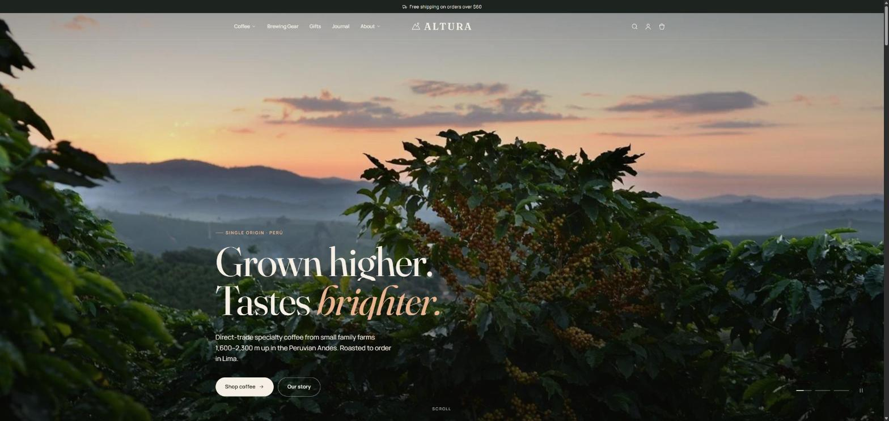
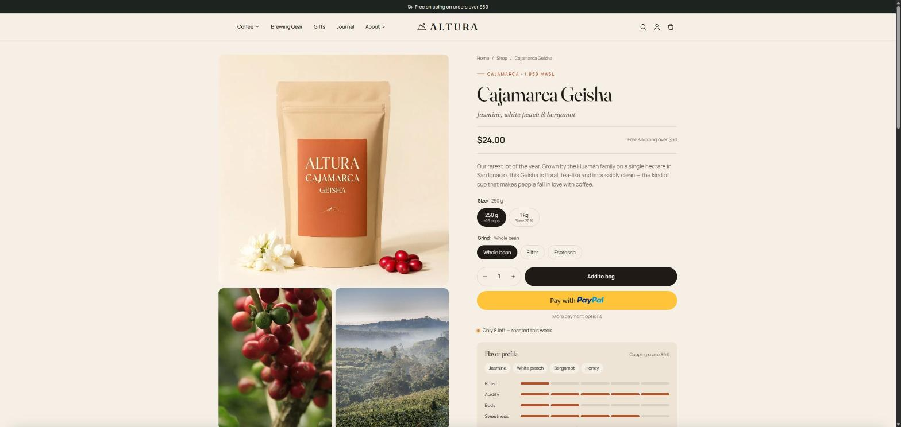
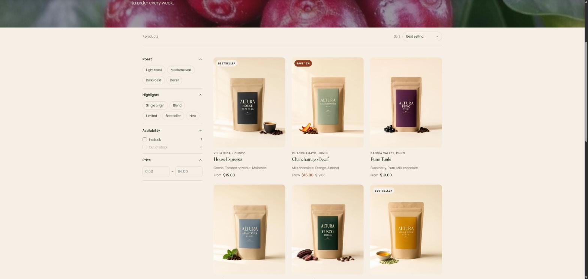
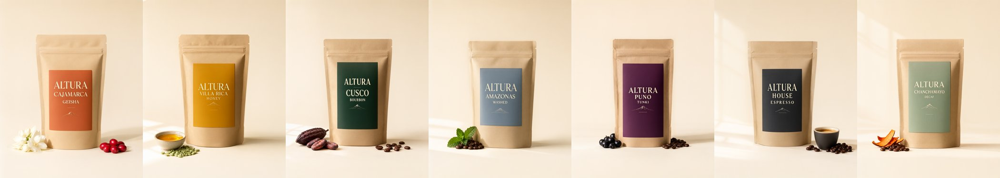

# Altura — Custom Shopify Theme

A fully custom Shopify Online Store 2.0 theme, built from scratch in Liquid, JSON templates, CSS and vanilla JavaScript — no Dawn, no starter theme, no theme apps.

**Altura** is a demo specialty-coffee brand from the Peruvian Andes, created to show a complete, production-style storefront: brand, catalog, content and theme.

**Live store:** [altura-coffee-store.myshopify.com](https://altura-coffee-store.myshopify.com)



| Product page | Collection with filters |
|---|---|
|  |  |



---

## What's custom

### Homepage sections
Every section has its own settings and blocks, so the whole page is editable with drag-and-drop in the theme editor.

- **Hero slideshow** — image or video per slide, line-by-line heading reveal, autoplay with progress dots and pause.
- **Tabbed featured collection** — each block is a collection; slider or grid layout.
- **Bento collection grid** with live product counts.
- **Origins explorer** — interactive region list with image cross-fade; each region links to a product.
- **Countdown drop** — limited-release banner tied to a product and an end date.
- **Shop the look** — hotspot blocks with product picker and x/y position.
- **Brew calculator** — choose method, cups and strength; returns dose, water, ratio and steps.
- **Testimonials, FAQ** (with FAQPage structured data), **timeline**, **journal** (latest blog posts), **social grid**, **newsletter** (Shopify customer form).

### Product page
- Reorderable blocks: title, price, description, buy buttons, flavor profile, perks, accordions.
- Variant picker built on `options_with_values` — color swatches / pills, unavailable combinations marked, price, stock, gallery and URL update on change.
- **Flavor profile from metafields** — 12 custom product metafields (tasting notes, region, altitude, process, variety, roast/acidity/body/sweetness meters).
- Live low-stock messaging from variant inventory.
- Dynamic checkout buttons, sticky add-to-cart bar, image lightbox, mobile swipe gallery.
- Product recommendations via the `product_recommendations` endpoint.
- Product JSON-LD structured data.

### Collection & search
- Shopify storefront filters (list, boolean, price range) + sorting, with counts.
- Tag-based filter chips (roast, highlights).
- Filtering, sorting and pagination update without page reloads via the **Section Rendering API**.
- Predictive search as you type, plus a mixed results page (products, pages, articles).

### Cart
- **AJAX cart drawer** re-rendered through the Section Rendering API on add / change / remove.
- Free-shipping progress bar (threshold is a theme setting), discount display, gift note saved to `cart.note`.
- Upsells from a chosen collection that skip items already in the cart.
- Full cart page with the same features.

### Also included
Mega menu with featured image, smart sticky header (transparent over the hero), mobile drawer menu, About / Contact page layouts, blog with tag filters, article page, 404, password page and gift card template. All theme colors, layout width, corner radius, animations and cart behavior are theme settings.

---

## Structure

```
theme/
  layout/      theme.liquid, password.liquid
  sections/    30+ custom sections + header/footer groups
  snippets/    product-card, price, icon set, cart helpers, meta tags
  templates/   JSON templates (index, product, collection, page.about, page.contact, ...)
  assets/      base.css, theme.js (no dependencies)
  config/      settings_schema.json, settings_data.json
tools/         Admin GraphQL scripts used to set up the store
```

### Store setup scripts (`tools/`)
The catalog and content are created through the **Shopify Admin GraphQL API**, so the whole store can be rebuilt from code:

- `catalog.py` — 7 smart collections and 14 products (`productSet`) with variants, inventory, SEO and metafields.
- `defs.py` — product metafield definitions.
- `content.py` — pages, blog and articles, and nested navigation menus.
- `upload_files.py` — staged uploads to Shopify Files.
- `templates_build.py` — generates the homepage, About and Contact templates.

## Run it locally

```bash
shopify theme dev --store your-store.myshopify.com --path theme
```

Push to a store:

```bash
shopify theme push --store your-store.myshopify.com --path theme --unpublished
```

---

Built by **Carlos Castillo** · [Touch Data](https://touchdata.pe)

Photography: [Pixabay](https://pixabay.com) (free license). Altura is a fictional brand; reviews and press names are demo content.
